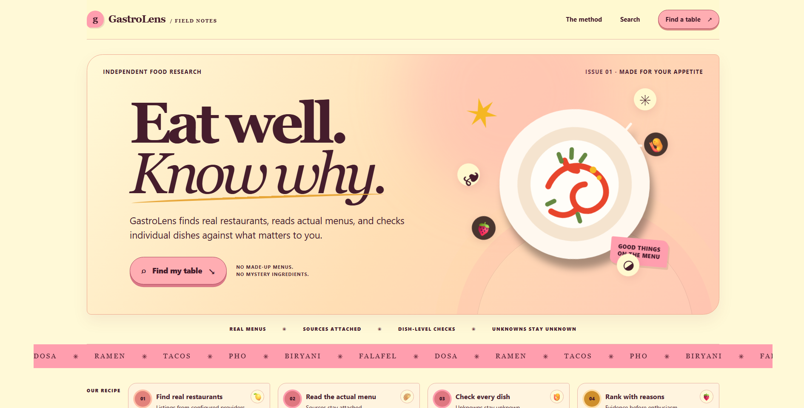
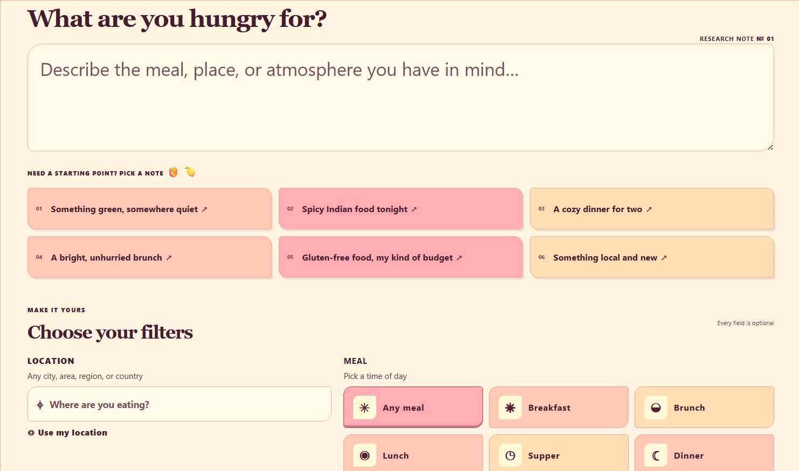
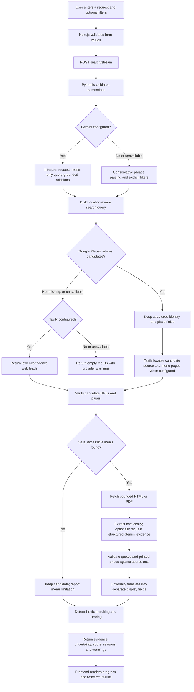
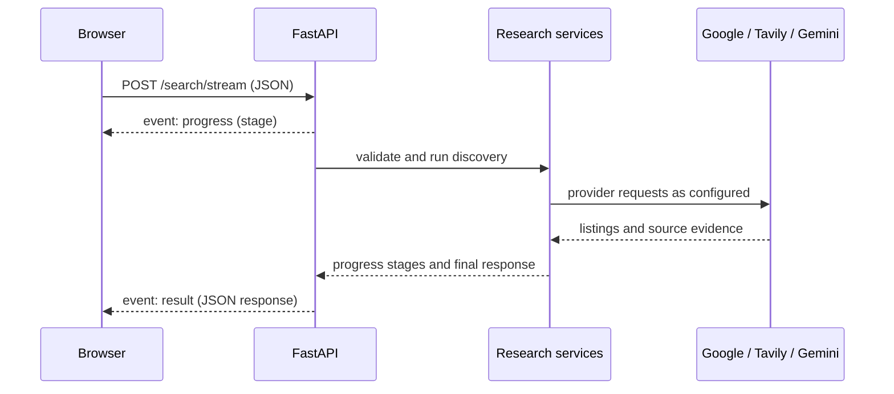

# GastroLens AI

**Evidence-first restaurant research for the meal you actually want.** GastroLens takes a natural-language request and optional filters, discovers restaurant candidates, looks for accessible menu sources, extracts menu evidence, and compares dishes with deterministic rules. The app shows where each important claim came from and leaves uncertain facts visibly uncertain.

Locations, currencies, cuisines, and dietary requirements are user-provided. There is no default city or dietary profile. Search coverage depends on the providers and their coverage in the requested area.

> GastroLens is a research aid. A menu listing or dietary label does not guarantee that a dish is currently available or safe for an allergy. Contact the restaurant to confirm critical requirements.

## Product preview

### Main interface



### Search and preferences



## Contents

- [What the application does](#what-the-application-does)
- [Product preview](#product-preview)
- [Research flow](#research-flow)
- [Repository layout](#repository-layout)
- [Requirements](#requirements)
- [Configuration](#configuration)
- [Run locally](#run-locally)
- [Search API](#search-api)
- [How evidence and matching work](#how-evidence-and-matching-work)
- [Providers and coverage](#providers-and-coverage)
- [Security and privacy](#security-and-privacy)
- [Checks](#checks)
- [Deployment](#deployment)
- [Known limitations](#known-limitations)
- [Project documentation](#project-documentation)

## What the application does

The current vertical slice includes:

- A responsive Next.js search experience with a natural-language request, optional location and filters, browser geolocation, streaming progress, cancellation, retry/error states, and evidence-focused results.
- A FastAPI backend with validated Pydantic request and response models, a JSON search route, and a Server-Sent Events (SSE) route for progress updates.
- Google Places as the primary structured restaurant discovery provider.
- Tavily as a best-effort web-search fallback for restaurant leads when Google Places is missing, unavailable, or returns no listings. Tavily also searches for source and menu pages for Google Places candidates.
- Safe retrieval and local extraction for supported HTML pages and text-based PDFs, with optional Gemini structured extraction, scanned-PDF OCR fallback, request interpretation, and translation.
- Deterministic per-dish and per-restaurant matching, ranking, and explanation. The language model does not make the final eligibility or ranking decision.
- Mocked backend and frontend tests so tests do not require provider credentials or paid calls.

Restaurant ratings, review counts, types, and price levels may appear when Google Places returns those fields. GastroLens does **not** retrieve review text, prove opening-hour availability, reserve tables, or claim complete geographic coverage.

## Research flow



### Live progress events

The browser consumes the streaming route. The backend sends `progress` events while researching, followed by exactly one terminal `result` or `error` event. Closing or canceling the browser request cancels the in-flight research task where supported by the server/runtime.



## Repository layout

```text
GastroLens-AI/
├── backend/
│   ├── app/
│   │   ├── api/routes/          # FastAPI health and restaurant endpoints
│   │   ├── core/                # Settings and structured logging
│   │   ├── integrations/        # Google Places, Tavily, Gemini adapters
│   │   ├── schemas/             # Pydantic API and evidence models
│   │   ├── services/            # Discovery, verification, menu research, matching
│   │   ├── db/                  # Database foundation (not used by current search flow)
│   │   └── main.py              # FastAPI application and CORS
│   ├── tests/                   # Deterministic mocked backend tests
│   ├── .env.example
│   ├── .python-version          # Render/runtime Python pin
│   ├── pyproject.toml
│   └── uv.lock
├── frontend/
│   ├── src/app/                 # Next.js App Router page, styles, and UI tests
│   ├── public/                  # Static visual assets
│   ├── .env.example
│   ├── package.json
│   └── package-lock.json
├── docs/
│   ├── architecture.md
│   ├── assumptions.md
│   ├── development.md
│   └── limitations.md
└── README.md
```

## Requirements

- Python **3.12 or 3.13**. The backend runtime pin is in `backend/.python-version` (`3.13.11`); `backend/pyproject.toml` allows `>=3.12,<3.14`.
- [`uv`](https://docs.astral.sh/uv/) for Python environments and dependencies.
- Node.js **20.9 or newer** and npm for the frontend.
- Provider credentials as described in [Configuration](#configuration). A local run without credentials can start, but external discovery/research features will return honest configuration or provider warnings rather than fabricated listings.

## Configuration

### Create local environment files

Run from the repository root in PowerShell:

```powershell
Copy-Item backend/.env.example backend/.env
Copy-Item frontend/.env.example frontend/.env.local
```

Or in macOS/Linux shells:

```bash
cp backend/.env.example backend/.env
cp frontend/.env.example frontend/.env.local
```

Edit `backend/.env` and enter your own provider keys. Never commit `.env` or `.env.local`. The repository ignore rules exclude local secret files; only placeholder values belong in `.env.example`.

### Backend variables

| Variable | Required | Purpose |
| --- | --- | --- |
| `GOOGLE_PLACES_API_KEY` | Recommended | Structured local restaurant listings and place identity. Enable Places API (New) in Google Cloud. |
| `TAVILY_API_KEY` | Recommended | Web-search fallback for restaurant leads and source/menu lookup. |
| `GEMINI_API_KEY` | Optional | Natural-language interpretation, structured menu extraction, scanned PDF OCR fallback, and translation. Without it, deterministic parsing/extraction still runs where possible. |
| `GEMINI_MODEL` | Optional | Gemini model identifier; default is `gemini-3.8-flash`. |
| `CORS_ORIGINS` | Set for deployment | Comma-separated exact browser origins allowed to call the API, e.g. `http://localhost:3000`. Use the deployed frontend origin in production. Wildcard origins are rejected. |
| `APP_ENV` | Optional | `development`, `test`, or `production`; defaults to `development`. |
| `LOG_LEVEL` | Optional | `DEBUG`, `INFO`, `WARNING`, `ERROR`, or `CRITICAL`; defaults to `INFO`. |
| `DATABASE_URL` | Optional / currently unused | PostgreSQL SQLAlchemy URL retained from the project foundation. The current restaurant search is not persisted and does not connect to PostgreSQL. |

See [backend/.env.example](backend/.env.example) for the placeholder template. Provider keys are read by FastAPI and are never included in the frontend bundle.

### Frontend variable

`frontend/.env.example` defines:

```dotenv
NEXT_PUBLIC_API_BASE_URL=http://localhost:8000
```

Set this to the backend's base origin (scheme and host, with an optional port), for example `https://your-api.example.com`. Do not include `/api/v1/...`; the client appends the endpoint path. The `NEXT_PUBLIC_` prefix means this value is public browser configuration, so never put secrets in it. If unset, the frontend defaults to `http://localhost:8000`.

### Provider setup references

- [Google Places API](https://developers.google.com/maps/documentation/places/web-service)
- [Tavily](https://docs.tavily.com/)
- [Gemini API](https://ai.google.dev/gemini-api/docs)

Provider access, quotas, and usage charges depend on your accounts and current provider plans. The application does not verify a credential when reporting its local configuration status.

## Run locally

Use two terminals from the repository root.

**Terminal 1 — backend**

```powershell
Set-Location backend
uv sync --dev
uv run uvicorn app.main:app --reload --host 127.0.0.1 --port 8000
```

**Terminal 2 — frontend**

```powershell
Set-Location frontend
npm ci
npm run dev
```

Open [http://localhost:3000](http://localhost:3000). FastAPI OpenAPI docs are at [http://localhost:8000/docs](http://localhost:8000/docs). The API liveness check is [http://localhost:8000/health](http://localhost:8000/health).

Check which provider variables are present without making paid network calls:

```powershell
Invoke-RestMethod http://localhost:8000/health/providers
```

The response reports a boolean `configured` value for each key and `live_checks_performed: false`. It does not validate that a configured key is accepted by its provider.

## Search API

### Routes

| Method | Path | Description |
| --- | --- | --- |
| `GET` | `/health` | Process liveness; does not depend on external services. |
| `GET` | `/health/providers` | Reports local key presence only; no provider requests. |
| `POST` | `/api/v1/restaurants/search` | Runs research and returns a JSON response. |
| `POST` | `/api/v1/restaurants/search/stream` | Same search with SSE `progress` and terminal `result`/`error` events; used by the web UI. |

### Request fields

The request is JSON. A location is required unless both latitude and longitude are provided. All user preference fields are optional.

| Field | Type | Validation / meaning |
| --- | --- | --- |
| `query` | string or null | Natural-language request, 3–500 characters when supplied. |
| `location` | string or null | Free-text city, area, region, or address, up to 160 characters. |
| `latitude`, `longitude` | number or null | Must be provided together and be within geographic bounds. Browser location is only used after user permission. |
| `search_radius_meters` | integer or null | 100–50,000 m. Without coordinates, it is only a query hint. |
| `meal` | string or null | `breakfast`, `brunch`, `lunch`, `supper`, or `dinner`. |
| `preferred_cuisine` | string or null | Legacy single cuisine field. |
| `preferred_cuisines` | string array | Up to 8 arbitrary cuisine terms. |
| `dietary_requirements` | string array | Up to 8 terms (each at most 50 characters). |
| `avoided_ingredients` | string array | Up to 30 terms. |
| `allergies` | string array | Up to 20 terms. |
| `max_budget_per_person` | number or null | Positive maximum; checked against individual printed dish prices. |
| `currency` | string or null | Three-letter currency code, normalized uppercase. No currency conversion is performed. |
| `target_language` | string or null | Optional language for separate translated display fields. |
| `party_size` | integer or null | 1–50. Suitability is not confirmed by current data providers. |
| `other_preferences` | string array | Up to 12 free-text preferences; discovery hints only unless evidence is available. |
| `max_results` | integer | 1–20; default 10. |

Terms are trimmed and duplicate entries are removed case-insensitively. Explicit structured filters take precedence over conflicting details parsed from the natural-language request.

### Example request

```json
{
  "query": "A relaxed vegetarian dinner in Kyoto under 4000 JPY",
  "location": "Kyoto",
  "meal": "dinner",
  "dietary_requirements": ["vegetarian"],
  "max_budget_per_person": 4000,
  "currency": "JPY",
  "target_language": "English",
  "max_results": 8
}
```

This is an example input only; it does not imply that any particular restaurant, menu, dish, or price will be returned.

### Response shape

Both search routes use `RestaurantSearchResponse` with these top-level fields:

| Field | Contents |
| --- | --- |
| `criteria` | Validated and interpreted request constraints. |
| `restaurants` | Ordered candidate records, including provider identity, optional rating/review count, source evidence, menu items, status, score, match reasons, and unknown fields. |
| `warnings` | Missing provider, fallback, incomplete source, and unverified-constraint notes. |
| `provider_coverage` | Plain-language note about the provider path and its limits. |

Each `source_evidence` record retains its URL, optional final URL, title/snippet, source classification, retrieval time, accessibility/HTTP status, and note. Each `menu_item` retains the source URL, exact evidence quote, retrieval timestamp, extraction confidence, original text, optional separate translation, printed price/currency when known, and deterministic dietary/allergen/match status. Fields absent from the evidence remain null or are listed in `unknown_fields`.

The streaming endpoint sends events as UTF-8 SSE frames, for example:

```text
event: progress
data: {"stage":"Searching location-aware restaurant listings"}

event: result
data: {"criteria":{...},"restaurants":[...],"warnings":[],"provider_coverage":"..."}
```

On an unexpected stream failure, it emits an `error` event with a safe user-facing message. The ordinary JSON endpoint returns standard FastAPI validation details for invalid requests.

## How evidence and matching work

### Verification statuses

| Status | Meaning in this implementation |
| --- | --- |
| `discovered` | A provider returned a candidate, but no accessible source consistency check has been established. |
| `partially_verified` | At least one source page was accessible, but identity/ownership evidence is incomplete. |
| `verified` | An accessible restaurant-site candidate contains the provider-supplied restaurant name. This is a consistency check, not proof of ownership or current operation. |

Restaurant verification is separate from menu extraction and from dietary suitability. A restaurant with `verified` status can still have an unknown menu, unknown dietary suitability, or stale business data.

### Dish and restaurant outcomes

Dish outcomes:

- `match`: the menu evidence supports requested dietary conditions and any budget check that can be performed.
- `partial`: some matching evidence exists, but at least one requested constraint is unresolved.
- `needs_checking`: available evidence cannot establish a safe/eligible match.
- `excluded`: source text conflicts with a hard requirement, such as an explicitly avoided ingredient or a comparable printed price over budget.

Restaurant outcomes:

- `exact_match`: supported by explicit menu evidence and satisfiable requested hard constraints.
- `partial_match`: some relevant evidence exists but a requested criterion remains unresolved.
- `uncertain`: important identity, location, menu, or constraint evidence is missing.
- `excluded`: a hard conflict is established, every comparable extracted price is over budget, the location is outside a coordinate-based radius, or the listing is reported closed by the provider.

Unknown dietary status never counts as a confirmed match. Absence of an allergen from a menu line is not evidence that the dish is allergy-safe. OCR output from a scanned PDF is marked `ocr_transcription` and remains unverified; it cannot by itself qualify a hard dietary or budget match.

### Deterministic score tiers

Restaurant scores use fixed evidence tiers rather than an unconstrained AI ranking:

| Score | Interpretation |
| ---: | --- |
| 90 | Exact evidence-backed match. |
| 60 | Partial evidence-backed match. |
| 35 | Important criteria remain uncertain. |
| 0 | Excluded by a hard conflict. |

Results sort by outcome (exact, partial, uncertain, excluded), score descending, restaurant name, then provider place ID. Location uncertainty caps the score at 35; out-of-radius or provider-reported closed listings are excluded. A score is an evidence tier, not a probability or guarantee.

### Budget and price handling

- A dish budget is checked using its printed menu price, not an inferred or typical price.
- To pass a requested budget, the extracted currency must match the user's explicit currency. No exchange rates are fetched and no conversion is applied.
- An ambiguous `$` is not guessed as USD, CAD, AUD, or another currency.
- The check is per dish. It does not establish that a full meal, tax, tip, or service charge fits the budget.
- A group/set-menu price does not become an individual dish price.
- If price or currency is missing or incomparable, the dish needs checking rather than being counted as within budget.

### AI boundary

Gemini can propose parsed fields or menu evidence, but source validation and application code determine what is retained. Proposed menu quotes must be found in retrieved text; printed price parsing is done locally. Translation is stored separately and cannot alter original text, price, evidence, or match status. If Gemini is unavailable, basic phrase parsing and local extraction continue where possible; more complex natural-language interpretation, OCR, and translation may be absent.

## Providers and coverage

### Google Places (primary discovery)

When configured, Places Text Search supplies structured listing data such as provider name, address, place ID, Maps URL, website, business status, coordinates, and—when returned by the configured API field mask and account tier—rating, review count, place type, and price level. Geographic coverage, freshness, and field availability vary. A search result is not a guarantee that every restaurant in an area was found.

### Tavily (web-search fallback and source lookup)

Tavily is used to find candidate source/menu pages and can provide restaurant leads when Places is missing, unavailable, or empty. Fallback results are explicitly lower confidence: the app cannot claim structured Google ratings, verified address, opening hours, or complete local coverage from Tavily. Coordinate-only discovery cannot fall back to text web search unless a textual location is also supplied.

### Gemini (optional research assistance)

Gemini supports query interpretation, structured menu extraction, bounded OCR fallback for certain scanned PDFs, and translation. A missing or rejected Gemini request does not create search results; warnings are surfaced and deterministic/local paths are used where possible. Configure `GEMINI_MODEL` if the default model is not enabled for your API key.

Provider setup status is available from `/health/providers`; it only checks whether environment variables are non-empty. It does not make live requests or validate account permissions. Provider outages, rate limits, missing keys, and malformed responses are handled as warnings/errors; the app does not fill gaps with sample data.

## Security and privacy

- Provider secrets are server-side settings. Only the backend receives Google, Tavily, and Gemini credentials.
- The frontend's `NEXT_PUBLIC_API_BASE_URL` is intentionally public and must contain only the backend origin.
- CORS is restricted to configured origins; use the exact frontend origin for deployment.
- Menu/source retrieval accepts HTTP(S) only and applies public-address checks, redirect validation, request timeouts, and response-size limits. Redirect destinations are rechecked. DNS validation and the eventual HTTP connection are separate; production egress filtering or DNS-pinned transport would further reduce DNS-rebinding risk.
- Search requests are processed synchronously and are not persisted. The current PostgreSQL foundation is not connected to the workflow.
- Search text and preferences are sent to configured external providers as needed to perform discovery and research. Review provider privacy and retention terms before production use.

## Checks

Run backend checks from `backend/`:

```powershell
uv run pytest
uv run ruff check app tests
```

Run frontend checks from `frontend/`:

```powershell
npm run lint
npm run typecheck
npm run test
npm run build
```

Tests use mocked HTTP/provider responses and do not need real API keys. Do not configure real keys in CI unless you deliberately want to run paid integration checks; the current test suite does not need live provider calls.

## Deployment

The intended split is a Next.js frontend deployed to Vercel and the FastAPI backend deployed to a Python-compatible ASGI host.

### Backend host

1. Set the service root to `backend/` (or set the host's working directory there).
2. Use Python `3.13.11` from `backend/.python-version`; the project supports Python `>=3.12,<3.14`.
3. Install dependencies with `uv sync --no-dev` or the host's supported `uv` workflow.
4. Start the ASGI app with `uv run uvicorn app.main:app --host 0.0.0.0 --port $PORT` (adapt the port syntax to the host).
5. Add provider keys and set `CORS_ORIGINS` to the exact deployed frontend origin.

### Vercel frontend

1. Set the project root directory to `frontend/`.
2. Set `NEXT_PUBLIC_API_BASE_URL` to the deployed backend base origin, without `/api/v1` or a trailing route.
3. Deploy and verify browser calls reach the backend's `/api/v1/restaurants/search/stream` endpoint.

The backend must be reachable over HTTPS from the deployed browser. Configure provider credentials only in the backend host's secret settings. PostgreSQL is not required for the current workflow because searches are not persisted.

## Known limitations

- Provider coverage is regional and incomplete; an empty result does not prove that no suitable restaurant exists.
- Arbitrary free-text locations are accepted, but location autocomplete/geocoding is not integrated. Ambiguous locations depend on provider interpretation.
- Text-only radius is a search hint. Distance filtering requires browser coordinates and candidate coordinates from Places.
- Cuisine identity, meal-time availability, party-size suitability, atmosphere, accessibility, and similar soft preferences cannot currently be verified from the available data and are shown as such.
- Google review text and opening hours are not retrieved. Rating and review count, when present, are listing metadata only.
- HTML pages and text-based PDFs are supported. Complex layouts, image-only web menus, anti-bot sites, and some scanned PDFs may not be readable.
- OCR is a suggestion from an image, not verifiable printed text. It cannot qualify hard budget or dietary constraints.
- Dietary labels do not establish kitchen practices, cross-contamination controls, ingredient substitutions, halal/kosher certification, or allergy safety. Confirm these directly with the restaurant.
- Menu content, prices, and provider listings can be outdated. Retrieval timestamps indicate when GastroLens fetched a source, not when the restaurant last updated it.
- Budget is per printed dish with an explicitly comparable currency, not an estimate of total meal cost. There is no currency conversion.
- There is no reservation, availability, review-analysis, user-account, persistence, or saved-search feature.
- SSRF checks validate DNS separately from outbound HTTP connection resolution; use network egress controls in production.

See [docs/limitations.md](docs/limitations.md) for the detailed limitation register and [docs/assumptions.md](docs/assumptions.md) for product assumptions.

## Project documentation

- [Architecture](docs/architecture.md) — component boundaries, provider flow, evidence and score decisions.
- [Assumptions](docs/assumptions.md) — product and implementation assumptions.
- [Limitations](docs/limitations.md) — coverage, extraction, verification, and security limits.
- [Development](docs/development.md) — local development notes and API contract.

## Contributing

Keep provider-specific logic behind integration adapters and keep hard-constraint decisions in deterministic service code. When adding an extracted fact, preserve its source, quote or field provenance, and retrieval time. Extend mocked tests for new evidence paths and failure states; never add fabricated restaurant or menu fixtures to live application responses.
